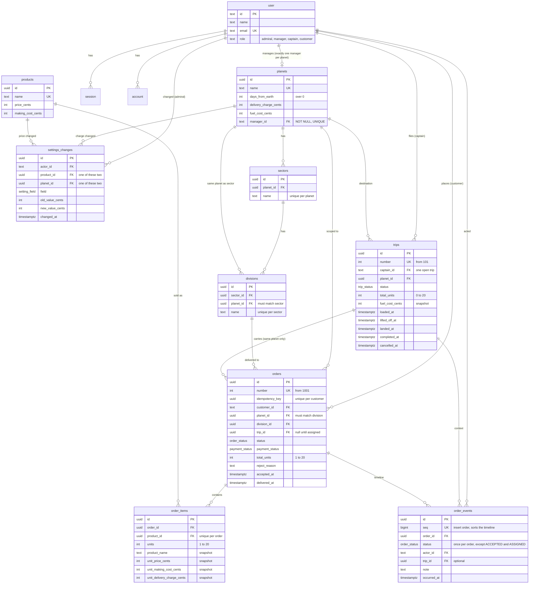

# Database Design

PostgreSQL 17, written as Drizzle schema in `src/db/schema/`.

**Status: approved and migrated locally (`drizzle/0001_domain.sql`, `drizzle/0002_triggers.sql`). Verified with 99 checks and one two-session race against the migration files.**

---

## 1. Plan

### Goals

1. **The database refuses bad data by itself.** If application code has a bug, an impossible row still cannot be saved.
2. **History never changes.** Prices are copied onto orders and trips. Triggers block every update and delete of those copies. Nothing is deleted.
3. **Easy to extend.** New products, roles, tables and columns are small migrations. A new status costs more, see section 6.

### Design rules

| Rule | How |
|---|---|
| Money | `integer` cents, `CHECK (x BETWEEN 0 AND 100000000)`. The cap is $1,000,000, the same as the input validation |
| Time | `timestamptz`, always UTC |
| IDs | `uuid` (`gen_random_uuid()`). Better Auth tables keep their text IDs |
| Human-readable numbers | Identity columns: orders start at 1001, trips at 101. Shown as `ORD-1001`, `TRP-101` |
| Fixed value sets | Postgres enums |
| Cross-column rules | `CHECK` constraints |
| "Must belong to the same planet" rules | Composite foreign keys |
| "Only one at a time" rules | Unique and partial unique indexes |
| Rules across rows or tables, and "never change this" | Triggers in `drizzle/0002_triggers.sql` (Drizzle does not model triggers) |
| Deletes | No cascades on business data. Every foreign key blocks the delete |

### Files

| File | Tables |
|---|---|
| `auth.ts` | `user`, `session`, `account`, `verification` (Better Auth) |
| `locations.ts` | `planets`, `sectors`, `divisions` |
| `catalog.ts` | `products`, `settings_changes` |
| `trips.ts` | `trips` |
| `orders.ts` | `orders`, `order_items`, `order_events` |
| `enums.ts` | `order_status`, `payment_status`, `trip_status`, `setting_field` |
| `columns.ts` | Shared column helpers |
| `drizzle/0002_triggers.sql` | 10 triggers, a hand-written migration |

13 tables: 4 from Better Auth, 9 ours.

---

## 2. ERD

`session`, `account` and `verification` are Better Auth internals and are left out of the attribute list.

The diagram shows what the database guarantees. An order always has at least one item and one event, and a planet has sectors, but that minimum is kept by the service and the seed, not by the database (see 4).

---

## 3. Tables

### 3.1 `user` (Better Auth, one column added)

| Column | Note |
|---|---|
| `role` | `admiral`, `manager`, `captain`, `customer`. Default `customer`. `CHECK` on the four values |

A user has no planet column. A manager's planet is found through `planets.manager_id` (see 3.2).

### 3.2 `planets`

| Column | Type | Rule |
|---|---|---|
| `name` | text | Unique |
| `days_from_earth` | int | > 0 |
| `delivery_charge_cents` | int | ≥ 0 |
| `fuel_cost_cents` | int | ≥ 0 |
| `manager_id` | text → user | **NOT NULL and UNIQUE** |

`manager_id` is the key idea. `NOT NULL` means a planet cannot exist without a manager. `UNIQUE` means one person cannot manage two planets. That is the planet side of decision D7.

The user side is not in the database: a user with role `manager` can exist without a planet, and `manager_id` can point to a user with another role. The seed is the only place staff are created, and the seed test checks both directions. A manager without a planet gets `FORBIDDEN` from every manager service.

Earth is not a row (D30).

### 3.3 `sectors`, `divisions`

| Table | Rule |
|---|---|
| `sectors` | Name unique inside a planet |
| `divisions` | Name unique inside a sector. Carries `planet_id`, and a composite foreign key `(sector_id, planet_id) → sectors (id, planet_id)` proves it is the sector's planet |

### 3.4 `products`

Name unique. Price and making cost between 0 and $1,000,000. Price below making cost is allowed (selling at a loss is a business choice).

### 3.5 `orders`

| Column | Rule |
|---|---|
| `number` | Identity, starts at 1001, unique |
| `idempotency_key` | Unique per customer. A double submit cannot create two orders |
| `planet_id` + `division_id` | Composite FK to `divisions (id, planet_id)`. The planet always matches the division |
| `trip_id` + `planet_id` | Composite FK to `trips (id, planet_id)`. **An order can only be on a trip to its own planet** |
| `total_units` | 1 to 20 |
| `status`, `payment_status` | Enums |

Cross-column checks:

| Check | Meaning |
|---|---|
| `orders_rejected_is_refunded` | REJECTED ⇔ REFUNDED |
| `orders_reject_reason_matches_status` | REJECTED ⇔ a reason exists |
| `orders_trip_matches_status` | No trip ⇔ status is PLACED, ACCEPTED or REJECTED |
| `orders_accepted_at_matches_status` | No `accepted_at` ⇔ status is PLACED or REJECTED |
| `orders_delivered_at_matches_status` | `delivered_at` exists ⇔ status is DELIVERED |
| `orders_timestamps_in_order` | created ≤ accepted ≤ delivered |

Triggers: an order is never deleted, and its customer, planet, division, `total_units`, idempotency key and `created_at` never change.

### 3.6 `order_items`

One row per product per order. Holds four snapshots taken at checkout: product name, unit price, unit making cost, unit delivery charge. Reports read only these, never the live `products` or `planets` rows.

A trigger blocks every `UPDATE` and `DELETE` on this table. A line is written once at checkout.

### 3.7 `order_events`

One row per status change: status, who did it, when, an optional note (reject reason, "Removed from trip") and an optional trip. This is the customer's timeline and the Admiral's audit trail.

| Rule | How |
|---|---|
| Append-only | Trigger blocks `UPDATE` and `DELETE` |
| Timeline order | `seq` identity column. Sort by `seq`, never by time |
| Honest time | `occurred_at` defaults to `clock_timestamp()`. `now()` is the transaction start, so two events in one transaction would share it |
| No duplicate step | Partial unique index on `(order_id, status)`. ACCEPTED and ASSIGNED are excluded: they repeat when an order leaves one trip and joins another |

### 3.8 `trips`

| Column | Rule |
|---|---|
| `number` | Identity, starts at 101 |
| `captain_id` | Partial unique index: one trip per captain where status is not COMPLETED or CANCELLED |
| `total_units` | 0 to 20 |
| `fuel_cost_cents` | Snapshot at creation. Frozen by a trigger |

Checks:

| Check | Meaning |
|---|---|
| `trips_not_empty_after_planning` | A trip that left PLANNING has at least 1 unit |
| `trips_cancelled_is_empty` | A CANCELLED trip holds 0 units |
| Five `*_at_matches_status` checks | Each timestamp exists exactly when the status says that step happened |
| `trips_timestamps_in_order` | created ≤ loaded ≤ lifted off ≤ landed ≤ completed |

Triggers on the row: a trip is never deleted. Captain, planet, fuel cost and `created_at` never change. `total_units` cannot change after PLANNING.

**Trip consistency, checked at commit** (deferred constraint trigger, fires on any change of an order's trip, units or status, and of a trip's units or status):

| Rule | Constraint name in the error |
|---|---|
| `trips.total_units` equals the sum of its orders' units. With the 0 to 20 check, this makes the 20 unit limit real | `trips_total_units_matches_orders` |
| Every order's status fits the trip's: PLANNING holds ASSIGNED, LOADED holds LOADED, LIFTED_OFF holds LIFTED_OFF, LANDED holds LANDED, AT_SECTOR or DELIVERED, COMPLETED holds DELIVERED, CANCELLED holds nothing | `trips_order_status_matches_trip` |
| A LANDED trip whose orders are all DELIVERED must be COMPLETED in the same transaction | `trips_all_delivered_is_completed` |

The check locks the trip row first, so two transactions on one trip are checked one after the other.

### 3.9 `settings_changes`

Two nullable foreign keys, `product_id` and `planet_id`. Exactly one is set. The `field` must fit the target: `price` and `making_cost` for a product, `delivery_charge` and `fuel_cost` for a planet. Old and new value must differ. Append-only by trigger.

---

## 4. Edge cases and what stops them

Verified by applying the schema and the triggers to a throwaway database and running 99 statements, each expected to fail or to pass. All 99 behaved as expected. One race was also run with two real sessions.

| Edge case | Stopped by |
|---|---|
| Planet without a manager | `manager_id NOT NULL` |
| One manager on two planets | `manager_id UNIQUE` |
| Unknown user role | `user_role_valid` |
| Planet 0 days away, negative charge or fuel | Checks |
| Any price, cost or charge above $1,000,000 | Range checks |
| Division placed on a different planet than its sector | Composite FK |
| Order with a planet that is not its division's planet | Composite FK |
| Order of 0 or 21 units | `orders_total_units_range` |
| Double-submitted checkout | Unique (customer, idempotency key) |
| Rejected but still paid, or refunded but not rejected | `orders_rejected_is_refunded` |
| Rejected without a reason | `orders_reject_reason_matches_status` |
| Placed order already on a trip, or assigned order with no trip | `orders_trip_matches_status` |
| **Order put on a trip to another planet** | Composite FK `orders_trip_planet_fk` |
| Accepted without `accepted_at`, delivered without `delivered_at` | Checks |
| Delivered before accepted, lifted off before loaded | `*_timestamps_in_order` |
| Same product twice in one order | Unique (order, product) |
| Item with 0 units or a negative snapshot price | Checks |
| **Price of a delivered order edited, or a line deleted** | Trigger `order_items_append_only` |
| Order units, customer or destination changed later. Order deleted | Triggers `orders_frozen_columns`, `orders_no_delete` |
| Timeline event edited or deleted | Trigger `order_events_append_only` |
| Two DELIVERED events for one order | Partial unique index `order_events_once_per_status` |
| Two events of one transaction in the wrong order | `seq` |
| Captain with two open trips | Partial unique index |
| **Trip over 20 units, even when the counter lies** | Range check plus `trips_total_units_matches_orders` |
| Order removed but the counter not lowered | `trips_total_units_matches_orders` |
| Trip loaded while empty | `trips_not_empty_after_planning` |
| Trip in a status without its timestamp | Five timestamp checks |
| Cancelled trip still holding units or orders | `trips_cancelled_is_empty` plus the commit check |
| **PLANNING trip holding a LOADED order. Trip COMPLETED while an order is still LOADED. Trip loaded but its orders left ASSIGNED** | `trips_order_status_matches_trip` |
| **New order added to a COMPLETED trip** (would raise old earnings) | Commit check plus `trips_units_frozen_after_planning` |
| **Two tabs deliver the last two stops at once and the trip stays LANDED forever** | `trips_all_delivered_is_completed`. Tested with two sessions: one commits, the other is refused and can retry |
| Fuel cost of a trip changed later. Trip deleted or moved to another captain | Triggers `trips_frozen_columns`, `trips_no_delete` |
| History row with no target, two targets, wrong field, or no change | Four checks |
| History row edited or deleted | Trigger `settings_changes_append_only` |
| Deleting a user, product, planet or order that has history | Foreign keys without cascade |

The seed reset uses `TRUNCATE`, which row triggers do not block. Tested.

### What the database does not enforce

These are enforced in the service layer and covered by tests. They are listed so nobody assumes otherwise.

| Rule | Why not in the database | Guard |
|---|---|---|
| `orders.total_units` = sum of its items | Would need another commit-time trigger for little gain | One function creates orders, and lines cannot change afterwards. Tested |
| An order has at least one item and one event. A planet has at least one sector | Same | `placeOrder` writes all three in one transaction. Seed test |
| Only valid status **transitions** for an order that is not on a trip (PLACED → ACCEPTED or REJECTED) | A check sees one row state, not the previous one | `UPDATE ... WHERE status = expected` plus the pure status machine. Tested |
| A trip does not skip a step (PLANNING straight to LANDED) | Same. The timestamp checks force every earlier timestamp to exist, but not that the steps happened in separate actions | Status machine. Tested |
| The `order_events` rows match the order's real status | The index stops duplicates, not a wrong event | Status change and event are written by one function in one transaction. Tested |
| All lines of one order carry the same delivery charge | The charge is stored per line on purpose (see 6) | `placeOrder` reads the planet once. Tested |
| `settings_changes.old_value_cents` is the value that was really there | A check cannot read another table | The service reads the row `FOR UPDATE`, then writes the new value and the history row in one transaction. Tested |
| Roles behind foreign keys: `manager_id` is a `manager`, `customer_id` a `customer`, `captain_id` a `captain`. Every manager has a planet | A foreign key cannot check another table's column | Staff exist only through the seed. Seed test checks both directions. Services check the session role |

### Things to know when writing queries

| Fact | Consequence |
|---|---|
| `(price + charge) * units` can pass the `integer` limit at the cap | Report SQL casts to `bigint` before multiplying |
| `SUM()` returns `bigint`, and node-postgres returns `bigint` as a string | Reports map sums to numbers in the service (safe: far below 2^53) |
| A rolled-back insert still uses an identity value | Order and trip numbers can have gaps. Cosmetic only |
| The commit check raises `check_violation` at `COMMIT`, not at the statement | Services treat it like any other constraint error and return `CONFLICT` |
| Swapping the managers of two planets hits the unique constraint | Not needed today. It would take a deferrable constraint |

---

## 5. Indexes

| Index | Serves |
|---|---|
| `orders (customer_id, created_at)` | Customer's order list |
| `orders (planet_id, status)` | Manager queue, planet orders, captain's available orders |
| `orders (trip_id)` | Orders of a trip |
| `orders (delivered_at)` | Report date ranges |
| `order_items (product_id)` | Planet × product report |
| `order_events (order_id, seq)` | Timeline |
| `order_events (trip_id)` | Events of a trip |
| `trips (captain_id, status)`, `trips (planet_id, status)`, `trips (completed_at)` | Captain history, Admiral lists, earnings |
| `settings_changes (changed_at)` and per target | History page |
| Unique indexes | Also serve the lookups by name, number and key |

---

## 6. Flexibility

| Future change | Cost | What it takes |
|---|---|---|
| Admiral adds or retires products | Easy | Add an `is_active` column. Old orders carry the product name and prices |
| Rename a product | Easy | Just rename. Orders keep the name they were sold under |
| Rename a planet, sector or division | Easy, with a caveat | Just rename. These names are **not** copied onto orders, so old orders show the new name. Add name snapshots first if that matters |
| Captain-owned ships with different capacity | Easy | Add a `ships` table and `trips.ship_id`. Move the 20 from a check to a column |
| Real payments and refunds | Easy | Add a `payments` table. `orders.payment_status` stays as the summary |
| Per-product delivery charge or weight | Easy | New columns on `products`. `order_items` already stores the charge per line |
| Stops as real records (proof of delivery, signature) | Easy | Add a `trip_stops` table. Today a stop is derived from orders |
| Several managers per planet, or swapping managers | Medium | Replace `planets.manager_id` with a `planet_managers` table. Every manager scope query changes |
| History for a non-money setting (for example `days_from_earth`) | Medium | The value columns are named `*_value_cents`. Rename them or add a second pair |
| New order or trip status (for example customer CANCELLED) | **Hard** | Two migrations: `ALTER TYPE ... ADD VALUE` must commit before the value can be used. Then rewrite the `⇔` checks that list statuses (up to 5 on `orders`) and the status map in `check_trip`. A CANCELLED order that is refunded also breaks "REJECTED ⇔ REFUNDED" |
| Events that are not a status change (a note, a refund) | **Hard** | `order_events.status` is NOT NULL. It needs a nullable status or a separate table |

The strict `⇔` checks are a deliberate trade: they refuse bad data today, and every new status has to be written into them. For a fixed, client-defined status list that is the right side of the trade.

---

## 7. Changes from the earlier plan

| Earlier (`plan.md`) | Now | Why |
|---|---|---|
| `user.planet_id` plus a unique index and a "manager ⇔ has a planet" check | `planets.manager_id NOT NULL UNIQUE` | The old way could only say "at most one manager per planet". This says "exactly one". Cost: "every manager has a planet" moved from a check to the seed test. It also leaves Better Auth's table almost untouched |
| `orders.code`, `trips.code` text from a sequence | `number` identity column, formatted when shown | Simpler, sortable, no string building in SQL |
| Idempotency key unique globally | Unique per customer | One customer cannot collide with another's key |
| `divisions` without a planet | `divisions.planet_id` with a composite FK | Lets the database prove an order's planet |
| Planet match of order and trip checked in code | Composite FK | The most important trip rule is now impossible to break |
| `settings_changes.entity` + `entity_id` | Two real foreign keys | No ID without a foreign key |
| No product name on items | `order_items.product_name` | Safe against a future rename |
| `order_events` without a trip | Optional `trip_id` | The timeline can say which trip |
| Status and timestamps loosely related | Checks tie each timestamp to its status, and keep them in order | A status cannot lie about what happened |
| "Append-only" by convention | Triggers on `order_events`, `settings_changes`, `order_items`, and frozen columns on `orders` and `trips` | Goal 2 is now true in the database |
| 20 unit limit kept by a counter | Commit-time check of the counter against the orders, plus order and trip status agreement | The client's hardest rule cannot be bypassed |
| Timeline sorted by `occurred_at` | `seq` identity column, `clock_timestamp()` | `now()` is the transaction start, so order could be wrong |
| Money cap only in validation | Range checks | Keeps report math safe |

Approved as D33 in `context.md`. `hld.md`, `lld/`, `plan.md` and the phase slices describe this design.

---

## 8. Review outcome and open questions

A review attacked the first version with 20 statements and found gaps between rows and tables. All of them are closed above or listed in "does not enforce". The three trigger questions were settled like this (approved, D33):

| # | Question | Answer in this version |
|---|---|---|
| Q1 | Should the database keep `total_units` in sync? | **Trip: yes**, checked at commit. Order vs items: no, lines are frozen and one function writes them |
| Q2 | Should the database block changes to history? | **Yes**, including `order_items` and the frozen columns of `orders` and `trips` |
| Q3 | Should the database check roles behind foreign keys? | **No.** Staff come only from the seed. The seed test checks it |

---

## 9. Migrations

| File | Holds | Made by |
|---|---|---|
| `drizzle/0000_auth.sql` | Better Auth tables | `npm run db:generate` |
| `drizzle/0001_domain.sql` | Enums, 9 domain tables, checks, indexes, `user_role_valid` | `npm run db:generate` |
| `drizzle/0002_triggers.sql` | 10 triggers and their functions | `drizzle-kit generate --custom`, written by hand |

Rules from now on:

- Drizzle does not see triggers. A migration that changes a status enum or a frozen column must also change the triggers in a new custom migration.
- The 99 checks become automated tests in the slices that own each table.
- Production (Neon) gets the same three files through `npm run db:migrate`.
