# Terra Supply Co. · High-Level Design

How the system is shaped and why. Decisions are referenced as D1 to D28 from `context.md`. Table columns, edge cases and work order live in `plan.md` and `phases/`.

---

## 1. Problem and goals

Terra Supply Co. ships supplies from Earth to every planet. Today it runs on spreadsheets and radio calls.

| Pain | Design answer |
|---|---|
| Orders get lost | One status per order, one owner per step, an append-only timeline, visible waiting time |
| Customers do not know where supplies are | Tracking page fed by the same timeline, with ETA |
| Nobody knows which planets are profitable | Reports computed in SQL from prices frozen on each order |

**Goals**

- Money and status are always correct, also under concurrent use.
- Each role sees only what it is allowed to see, enforced on the server.
- A reviewer can try every role on a live URL in minutes.

**Non-goals**

Real payments, refunds as a process, notifications, inventory, route planning, staff management UI, horizontal scaling, real-time push (D9, `project.md` 9.3).

**Scale assumption:** small. Tens of users, thousands of orders. The design favors correctness and clarity over throughput.

---

## 2. System context

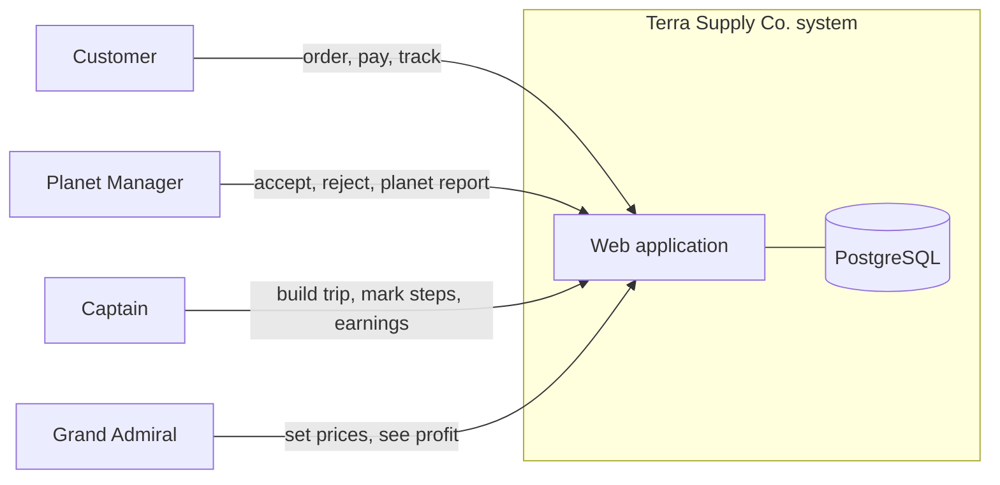

There are no external systems. Payment is simulated (D2). All users reach the system through a browser.

---

## 3. Architecture overview

One deployable unit: a Next.js application that renders the UI and runs the business logic, backed by one PostgreSQL database.

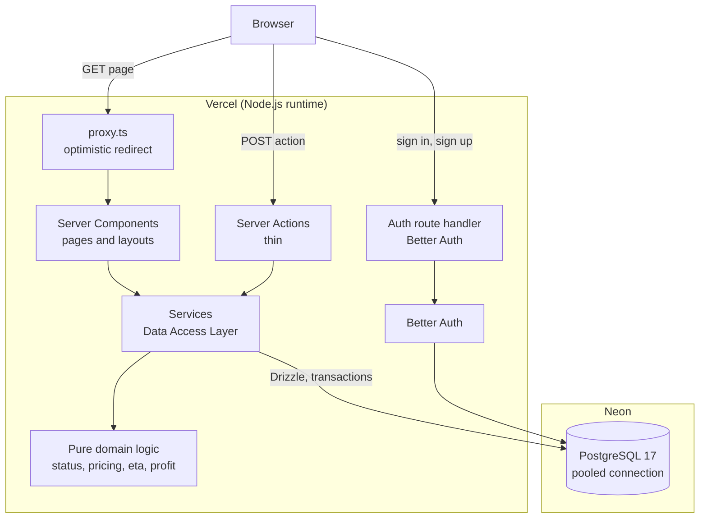

| Part | Technology | Responsibility |
|---|---|---|
| UI | React Server Components, shadcn/ui, Tailwind | Render pages on the server. Client Components only where state or events are needed |
| Mutations | Server Actions | Validate input, call a service, revalidate, return a small result |
| Business logic | Services (`service.ts` per feature) | The only code that touches the database. Does every access check |
| Domain rules | Pure TypeScript functions | Status machines and money formulas, with no I/O |
| Auth | Better Auth | Password hashing, sessions in the database, cookies |
| Data | PostgreSQL via Drizzle | Storage, constraints, transactions, aggregation |
| Hosting | Vercel + Neon | Serverless functions and managed Postgres |

**Why a single application:** one team, one weekend, small scale. A separate API or separate services would add deployment and contract work with no benefit. The service layer keeps the option open: it has no dependency on Next.js, so it could sit behind an API later.

---

## 4. Code structure

Feature-based, with a Data Access Layer, as recommended by the Next.js docs (D14).

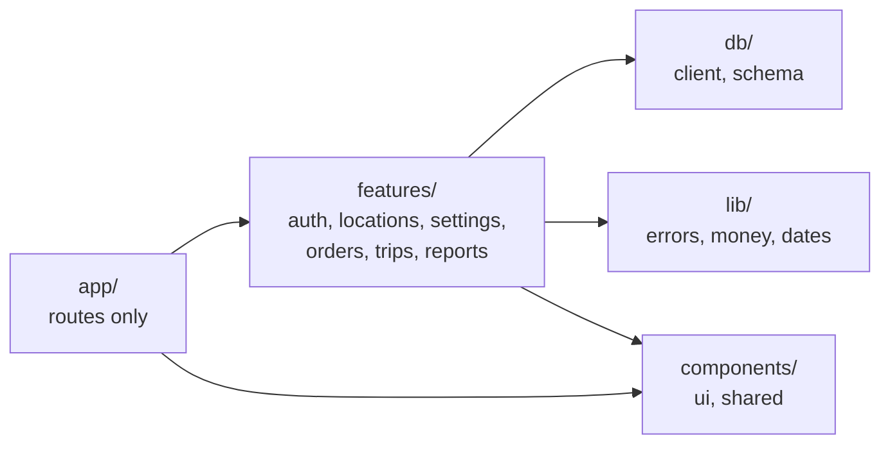

Imports go one way only. `db` and `lib` never import from features or routes.

Inside each feature:

| File | Role |
|---|---|
| `service.ts` | Server only. Reads and writes. Access checks. Returns DTOs |
| `actions.ts` | Server Actions. Zod parse → service → revalidate → `ActionResult` |
| `schemas.ts` | Zod input schemas, shared by forms and actions |
| `status.ts`, `pricing.ts`, … | Pure rules. Unit tested in isolation |
| `components/` | Feature UI |

**Why this shape**

- Access control has one home. A page or action cannot read data without passing through a service, and every service function begins with the check.
- Pure rules are separated from I/O, so the parts where a bug costs money are the easiest parts to test.
- Server Actions stay thin, so they can be reviewed as public endpoints at a glance.

---

## 5. Request flows

### 5.1 Read

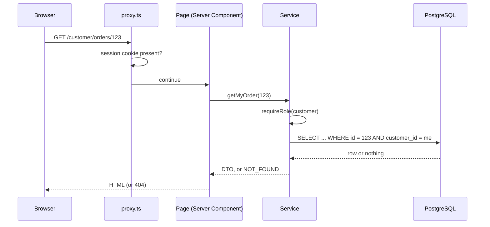

The proxy check is only a fast redirect. The real check is the scoped query in the service.

### 5.2 Write

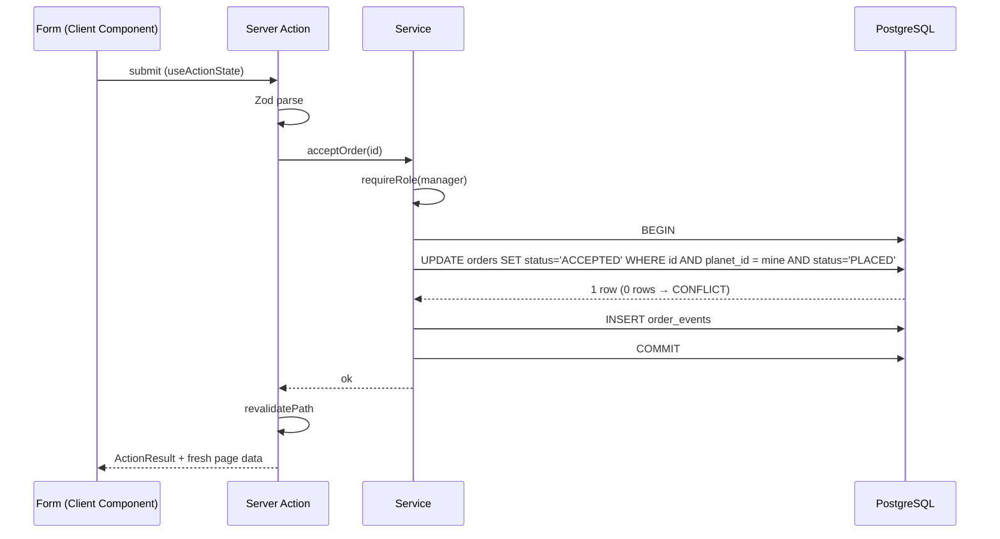

### 5.3 Two captains, one order

The one place where concurrent users compete for the same record.

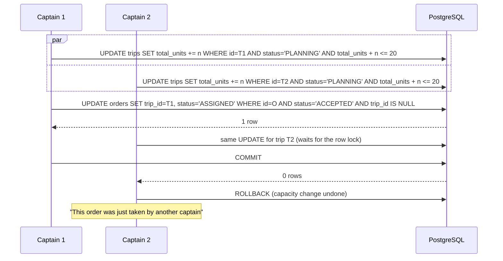

No application lock is needed here. The first `UPDATE` takes the trip's row lock and the condition is inside the `UPDATE`, so the database decides the winner atomically. Actions that do not start by updating the trip (delivering a stop) first lock the trip row with `SELECT ... FOR UPDATE`. At commit the database re-checks the trip: units match the orders, order statuses fit the trip, and a fully delivered trip is COMPLETED (`database.md` 3.8).

---

## 6. Domain model

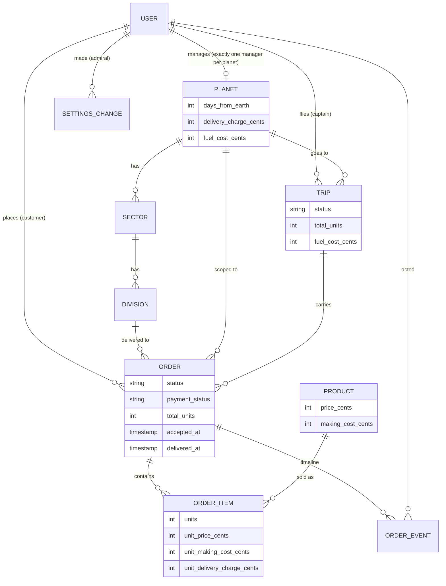

| Concept | Key idea |
|---|---|
| Order | One customer, one division, 1 to 20 units. Never split |
| Order item | Carries its own copy of price, making cost and delivery charge |
| Trip | One captain, one planet, at most 20 units. Carries its own copy of fuel cost |
| Stop | Not a table. The orders of one trip that share a division |
| Earth | Not a row. It is the fixed origin of every trip and never a destination (D30) |
| Order event | One row per status change. The timeline customers see and the audit trail the Admiral sees |

---

## 7. Lifecycles

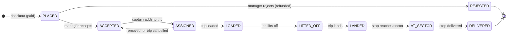

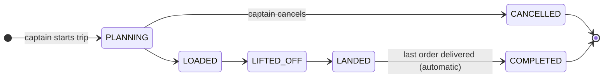

**Who moves what**

- Customer creates. Manager decides. Captain moves everything after that.
- Trip-level steps (Loaded, Lifted off, Landed) move all orders of the trip together.
- After landing, each division stop moves on its own, in any order (D25).
- Time is not enforced. Captains mark steps by hand and the ETA is an estimate (D6).

---

## 8. Money

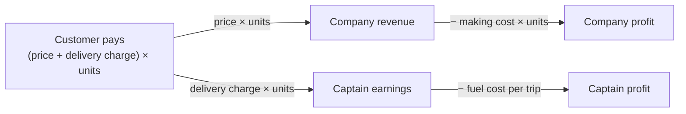

| Decision | Reason |
|---|---|
| Integer cents everywhere | No floating-point rounding in money |
| Prices frozen on the order line, fuel cost frozen on the trip | The Admiral can change prices at any time. Reports must not change when a price changes |
| One counting rule: delivered (D11) | The Admiral asked "what was delivered". Using the same rule for all three roles means their numbers always agree |
| Reports aggregate in SQL | One source of truth, no drift between a stored total and the rows behind it |
| Payment is a status: PAID, then REFUNDED on rejection (D2 to D4) | Models the customer's experience without a payment provider |

---

## 9. Security

### 9.1 Authentication

- Better Auth with email and password. Passwords are hashed by the library. Sessions are stored in the database and sent as an HTTP-only cookie.
- Customers sign up publicly. `role` and `planetId` cannot be set by the client (`input: false`), so sign-up can only ever create a customer (D8).
- Staff accounts exist only through the seed (D9).

### 9.2 Authorization

Three layers, each weaker than the next one below it:

| Layer | What it does | Trusted for security? |
|---|---|---|
| `proxy.ts` | Redirects visitors without a session cookie | No. Convenience only |
| Role layouts | Redirect a wrong role to its own home | No. Convenience only |
| Services | Check session, role and scope on every call. Queries include the scope in `WHERE` | **Yes. The only real boundary** |

### 9.3 Data scoping

| Role | Scope applied in every query |
|---|---|
| Customer | `customer_id = me` |
| Manager | `planet_id = my planet`, and a column list without making cost or profit |
| Captain | `captain_id = me` for trips. Available orders limited to the trip's planet and status ACCEPTED. Sees products and units, never prices, cost or customer (D29) |
| Admiral | No scope. Read-only outside settings |

A record outside scope is answered exactly like a record that does not exist, so IDs cannot be probed.

### 9.4 Other

- Server Actions are treated as public endpoints: authenticate, authorize, validate, return only what the UI needs.
- All input is validated with Zod on the server. Queries are parameterized by Drizzle.
- Secrets live in environment variables, validated at startup.
- Next.js checks the `Origin` of Server Action requests (CSRF).

---

## 10. Consistency and concurrency

| Risk | Protection |
|---|---|
| Two captains take one order | Conditional `UPDATE` on the order row. One row changed, or conflict |
| A trip over 20 units | Conditional `UPDATE` on the trip, a `CHECK` on the counter, and a commit-time check that the counter equals the orders |
| A captain with two open trips | Partial unique index |
| A planet with no manager, or one manager on two planets | `planets.manager_id NOT NULL UNIQUE` (D7) |
| Order and trip status drift apart, or a trip stays LANDED after its last delivery | Commit-time trigger on the trip. The losing transaction gets a conflict and retries |
| Prices of a past order or trip edited later | Triggers make snapshots, events and settings history append-only |
| Timeline shown in the wrong order | Events sort by an identity `seq`, not by time |
| A step applied twice (double click, stale tab) | Every transition is `UPDATE ... WHERE status = expected`. The second call changes nothing |
| Status and timeline disagree | Both are written in one transaction |
| An order placed twice | Unique idempotency key on the order |
| Customer pays a price they did not see | Checkout sends the expected total. The server compares and blocks on mismatch (D23) |
| Impossible combinations (rejected but paid, in a trip but only placed) | `CHECK` constraints across columns |

Principle: the application states the rule, and the database enforces it. If application code has a bug, the database still refuses bad data.

---

## 11. Rendering and caching

| Topic | Choice | Reason |
|---|---|---|
| Rendering | Server Components, dynamic on every request | Every page is per-user and must be current |
| Cache Components | Off | No benefit for per-user pages, and it adds rules to every route |
| Data cache | None | Wrong money or status is worse than a slower page |
| After a mutation | `revalidatePath` for affected pages | The response of the action already carries fresh data |
| Live updates | Polling every 10 seconds on three pages (D24) | Simple and enough at this scale. No WebSocket infrastructure |
| Lists | Offset pagination, 20 rows, state in the URL | Simple, shareable, good enough for thousands of rows |
| Indexes | On the scope and status columns each role filters by | Every list query is an index lookup |

---

## 12. Deployment

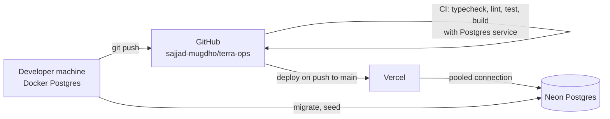

| Environment | App | Database |
|---|---|---|
| Local | `next dev` | Docker Postgres, database `terra_ops` |
| Test | Vitest | Same Docker Postgres, database `terra_ops_test` |
| CI | GitHub Actions | Postgres service container |
| Production | Vercel | Neon, pooled connection string |

- Schema changes are SQL migrations in the repo, generated by drizzle-kit.
- Configuration is three environment variables: `DATABASE_URL`, `BETTER_AUTH_SECRET`, `BETTER_AUTH_URL`.
- Demo data is created and reset by one seed command (D20).

---

## 13. Testing strategy

| Layer | What | How |
|---|---|---|
| Pure rules | Status machines, money formulas, ETA, profit, pagination | Unit tests, no database |
| Services | Permissions, scoping, races, snapshots, constraints, reports | Integration tests on a real PostgreSQL (D21) |
| Flows | Each role's journey | By hand on the live URL at each phase gate |

Races are tested with real parallel calls against a real database. A mock cannot prove that only one captain wins.

---

## 14. Errors and failure modes

| Situation | Behavior |
|---|---|
| Invalid input | `ActionResult` with field errors. The form keeps the user's values |
| Not allowed, or not in scope | "Not found", or redirect to the role home |
| Lost a race or stale page | Clear message ("This order was just taken by another captain") and fresh data |
| Unexpected error | Reaches the route's `error.tsx`. The transaction has rolled back, so no partial state |
| Database unavailable | Request fails and shows the error page. No retries, no queue |
| Missing environment variable | Build or startup fails with the variable's name |

Observability is limited to Vercel's request and function logs. Structured logging, metrics and alerting are out of scope.

---

## 15. Trade-offs

| Chosen | Instead of | Cost accepted |
|---|---|---|
| One Next.js app | Separate API and frontend | No API for other clients yet |
| Server Actions | REST endpoints | Tied to the web UI |
| Conditional updates | Row locks or a queue | Losers of a race must retry by hand |
| Manual step marking | Simulated clock | A captain can land "early". ETA is only an estimate |
| Polling | WebSockets or SSE | Up to 10 seconds of delay, extra queries |
| Aggregating on read | Stored totals or materialized views | Dashboard cost grows with order count |
| Offset pagination | Cursor pagination | Rows can shift between pages when data changes |
| Seed-only staff | Staff management UI | The Admiral cannot add a captain |
| Status-only refund | Payment and refund records | No ledger to reconcile |
| Timeline as audit trail | Full audit log of every read and write | Only status changes and settings changes are recorded |

---

## 16. What would change at larger scale

| Need | Change |
|---|---|
| Other clients (mobile, partners) | Put the existing services behind an HTTP API |
| Many more orders | Materialized or incrementally updated report tables. Cursor pagination |
| Instant updates | Server-sent events fed by Postgres `LISTEN/NOTIFY` |
| Real money | Payment provider, a ledger table, refunds as records |
| More staff | Staff management, replace-manager flow, account deactivation |
| Unpicked orders | Assignment rules or incentives, since captains avoid loss-making trips |
| Operations | Structured logs, error tracking, rate limiting, read replicas, Redis for reference data |
