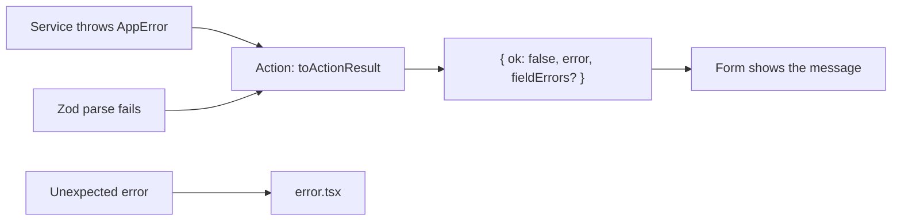
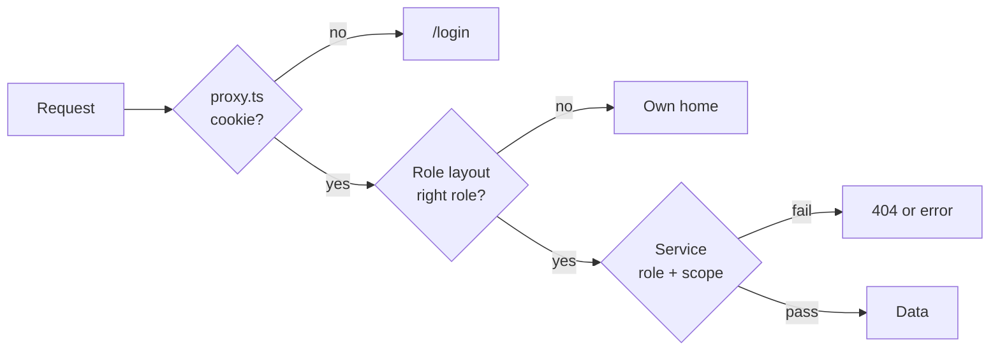

# Shared building blocks

Small pieces every feature uses. Nothing here knows about orders or trips.

---

## 1. Files

| File | Holds |
|---|---|
| `src/lib/errors.ts` | `AppError` |
| `src/lib/action-result.ts` | `ActionResult`, `FormState`, `toActionResult()` |
| `src/lib/pg-error.ts` | `isPgError()`: reads a Postgres error code and constraint through Drizzle's wrapper |
| `src/lib/money.ts` | `formatMoney()`, `parseDollarsToCents()`, `centsToDollarText()` |
| `src/lib/dates.ts` | `formatUtc()`, `formatUtcTime()`, `formatDuration()`, `addDays()` |
| `src/lib/pagination.ts` | `PAGE_SIZE`, `Paged<T>`, `parsePage()`, `pageWindow()`, `pageHref()` |
| `src/lib/search.ts` | `parseSearch()`, `likePattern()` |
| `src/lib/polling.ts` | `startPolling()`: the timer behind `AutoRefresh`, with no React in it |
| `src/lib/auth.ts`, `auth-client.ts` | Better Auth config (exists) |
| `src/db/index.ts`, `src/db/schema/*` | Drizzle client and tables (exists) |
| `src/env.ts` | Validated env vars (exists) |
| `src/proxy.ts` | Optimistic redirect |

---

## 2. Errors

One error class. Services throw it. Actions convert it.

| Code | Meaning | What the user sees |
|---|---|---|
| `UNAUTHORIZED` | No session | "Please log in again" |
| `FORBIDDEN` | Wrong role | Redirect home, or "Not allowed" |
| `NOT_FOUND` | Missing, or outside the user's scope | 404 page, or "Not found" |
| `CONFLICT` | State changed, or lost a race | The specific message, e.g. "This order was just taken by another captain" |
| `INVALID` | Bad input | Field errors next to the inputs |

---

## 3. Helpers

| Function | In → Out | Notes |
|---|---|---|
| `formatMoney(cents)` | `1250` → `$12.50` | Negative → `-$15.00` |
| `parseDollarsToCents(text)` | `"12.5"` → `1250` | Works on the string. Rejects negatives, 3+ decimals, non-numbers |
| `centsToDollarText(cents)` | `1250` → `12.50` | The starting text of a money input |
| `formatUtc(date)` | Date → `21 Nov 2026, 14:05 UTC` | Always UTC, always labelled |
| `formatUtcTime(date)` | Date → `14:05:09 UTC` | For "Updated ..." on live pages |
| `formatDuration(from, to)` | → `1d 2h`, `1h 5m`, `5m` | Under a minute → `0m` |
| `addDays(date, n)` | → Date | Used for ETA |
| `parsePage(value)` | `"abc"` → `1` | Only a whole number of 1 or more is a page |
| `pageWindow(page, total)` | → `{ page, pageCount, offset, limit }` | 20 rows per page. A page past the end becomes the last page |
| `pageHref(path, params, page)` | → `/x?q=a&page=2` | Keeps the filters. Leaves out page 1 and empty values |
| `parseSearch(value)` | `"  ord-1  "` → `ord-1` | Trimmed, cut at 100 characters. Only spaces → no search |
| `likePattern(text)` | `50%` → `%50\%%` | Escapes `%`, `_` and `\`, so they match themselves |
| `startPolling(tick, ms, document)` | → stop function | Ticks while the tab is visible, once right away when it comes back |

---

## 4. Shared components

| Component | Type | Purpose |
|---|---|---|
| `AppShell` | Server | Composes the sidebar, the header and the page content (D62) |
| `app-nav.ts` | Pure | Pages of each role in groups. `activeNav` (longest match) and `crumbsFor` |
| `AppSidebar` | Client | Brand, grouped pages with icons, user, log out. Collapses to icons, a drawer on phones |
| `AppHeader` | Client | Sidebar toggle, breadcrumb, theme toggle |
| `ThemeToggle` | Client | Flips the `dark` class and writes the `theme` cookie that the root layout reads |
| `StatCard`, `Delta` | Server | One headline number with an icon and a hint. `Delta`: change against the period before |
| `MoneyTrendChart` | Client | Money over time on one axis. One series has a light fill, more have lines and a legend (D64) |
| `MoneyBarChart` | Client | Ranked horizontal bars with the amount at the tip, or columns per category (D64) |
| `StatusBadge` | Server | Outline badge with a colored dot. The feature passes the text and the tone |
| `Money` | Server | Formats cents. Red with a minus when negative |
| `DataTable` | Server | Table with an empty state |
| `Pagination` | Server | The total count, and previous, next, "Page x of y" as links when there is more than one page |
| `ListFilters` | Server | Search box and selects (status, planet, ...) as a GET form, with a "Clear" link |
| `DateRangeFilter` | Client | From and to, as a GET form. Stops a start date after the end date |
| `AutoRefresh` | Client | `router.refresh()` every 10s while the tab is visible. Shows "Updated <time> UTC", the server time of the last render |
| `SubmitButton` | Client | Disabled and shows a spinner while pending |
| `ActionButton` | Client | One button that runs one Server Action with hidden fields and shows its error |
| `FormError` | Client | Shows `ActionResult.error` |

---

## 5. Guard chain

Only the last box is a security boundary. The first two are for a good user experience.
