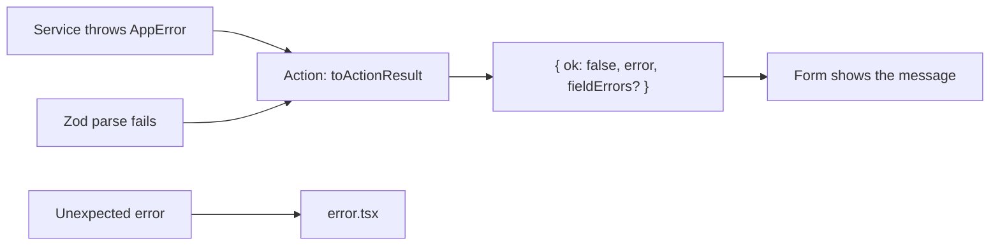
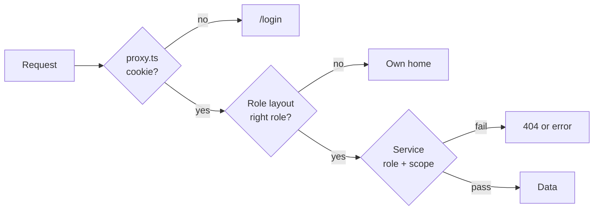

# Shared building blocks

Small pieces every feature uses. Nothing here knows about orders or trips.

---

## 1. Files

| File | Holds |
|---|---|
| `src/lib/errors.ts` | `AppError` |
| `src/lib/action-result.ts` | `ActionResult`, `toActionResult()` |
| `src/lib/money.ts` | `formatMoney()`, `parseDollarsToCents()` |
| `src/lib/dates.ts` | `formatUtc()`, `formatDuration()`, `addDays()` |
| `src/lib/pagination.ts` | `parsePage()`, `pageWindow()` |
| `src/lib/auth.ts`, `auth-client.ts` | Better Auth config (exists) |
| `src/db/index.ts`, `src/db/schema/*` | Drizzle client and tables (exists) |
| `src/env.ts` | Validated env vars (exists) |
| `src/proxy.ts` | Optimistic redirect |

---

## 2. Errors

One error class. Services throw it. Actions convert it.

| Code | Meaning | What the user sees |
|---|---|---|
| `UNAUTHORIZED` | No session | "Please log in again" |
| `FORBIDDEN` | Wrong role | Redirect home, or "Not allowed" |
| `NOT_FOUND` | Missing, or outside the user's scope | 404 page, or "Not found" |
| `CONFLICT` | State changed, or lost a race | The specific message, e.g. "This order was just taken by another captain" |
| `INVALID` | Bad input | Field errors next to the inputs |

---

## 3. Helpers

| Function | In → Out | Notes |
|---|---|---|
| `formatMoney(cents)` | `1250` → `$12.50` | Negative → `-$15.00` |
| `parseDollarsToCents(text)` | `"12.5"` → `1250` | Works on the string. Rejects negatives, 3+ decimals, non-numbers |
| `formatUtc(date)` | Date → `21 Nov 2026, 14:05 UTC` | Always UTC, always labelled |
| `formatDuration(from, to)` | → `2d 5h` | Under a minute → `Just now` |
| `addDays(date, n)` | → Date | Used for ETA |
| `parsePage(value)` | `"abc"` → `1` | Clamps to ≥ 1 |
| `pageWindow(page, total)` | → `{ offset, limit, pageCount }` | 20 rows per page |

---

## 4. Shared components

| Component | Type | Purpose |
|---|---|---|
| `AppShell` | Server | Header, role nav, user name, log out |
| `StatusBadge` | Server | Colored label for an order or trip status |
| `Money` | Server | Formats cents. Red with a minus when negative |
| `DataTable` | Server | Table with an empty state |
| `Pagination` | Server | Previous, next, "Page x of y" as links |
| `ListFilters` | Client | Search box and status select, as a GET form |
| `DateRangeFilter` | Client | From and to, as a GET form |
| `AutoRefresh` | Client | `router.refresh()` every 10s while the tab is visible |
| `SubmitButton` | Client | Disabled and shows a spinner while pending |
| `FormError` | Client | Shows `ActionResult.error` |

---

## 5. Guard chain

Only the last box is a security boundary. The first two are for a good user experience.
