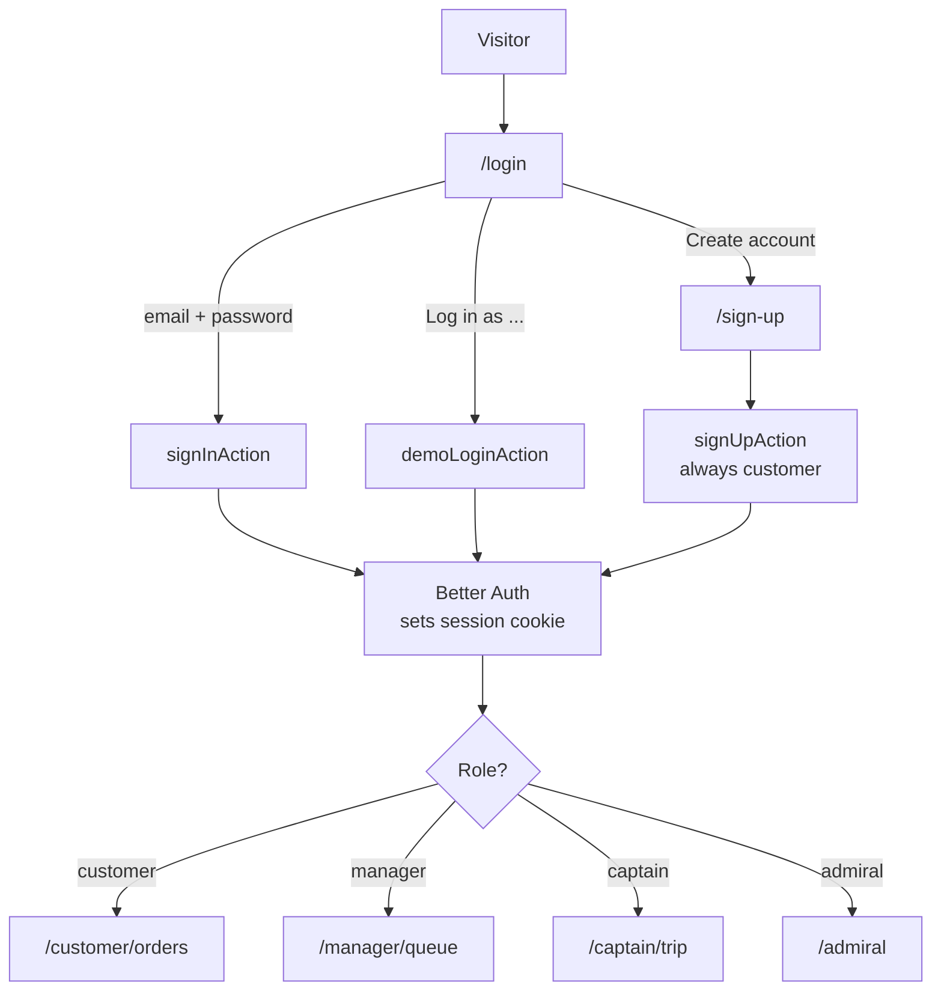

# Auth

## 1. What it does

Lets people sign in, lets customers sign up, and tells every other feature who is asking.

## 2. Files

| File | Holds |
|---|---|
| `features/auth/session.ts` | `getCurrentUser`, `requireUser`, `requireRole` |
| `features/auth/roles.ts` | Role list, role home URLs |
| `features/auth/demo-users.ts` | The seeded demo accounts (also read by the seed) |
| `features/auth/schemas.ts` | Sign-in and sign-up schemas |
| `features/auth/actions.ts` | 4 actions |
| `features/auth/components/` | `LoginForm`, `SignUpForm`, `DemoLoginList` |
| `app/(auth)/login`, `app/(auth)/sign-up` | Pages |
| `app/api/auth/[...all]/route.ts` | Better Auth handler |

## 3. Data it owns

Better Auth tables: `user`, `session`, `account`, `verification`.

Extra column on `user`:

| Column | Values | Rule |
|---|---|---|
| `role` | `admiral`, `manager`, `captain`, `customer` | Default `customer`. Client can never set it |

A manager's planet lives on the planet: `planets.manager_id` is `NOT NULL UNIQUE` (`database.md` 3.2). Staff are created only by the seed, and the seed test checks that every manager has exactly one planet.

Role homes:

| Role | Home |
|---|---|
| Customer | `/customer/orders` |
| Manager | `/manager/queue` |
| Captain | `/captain/trip` |
| Admiral | `/admiral` |

## 4. Server Actions

| Action | Input | Steps | Result |
|---|---|---|---|
| `signInAction` | email, password | Trim and lowercase email → Better Auth sign in | Redirect to role home. Wrong details → "Invalid email or password" |
| `signUpAction` | name (2–60), email, password (8–128) | Validate → Better Auth sign up (always customer) | Redirect to `/customer/orders`. Duplicate → field error on email |
| `demoLoginAction` | email | Email must be in `demo-users.ts` → sign in with the demo password | Redirect to role home. Other email → `FORBIDDEN` |
| `signOutAction` | — | Better Auth sign out | Redirect to `/login` |

## 5. Service functions

| Function | Returns | Throws |
|---|---|---|
| `getCurrentUser()` | `{ id, name, email, role, planetId }` or `null`. `planetId` is not a user column: for a manager it is read from `planets.manager_id`, for everyone else it is `null` | — |
| `requireManagerPlanet()` | `{ user, planetId }` | `UNAUTHORIZED`, `FORBIDDEN` (not a manager, or a manager no planet points to) |
| `requireUser()` | User | `UNAUTHORIZED` |
| `requireRole(...roles)` | User | `UNAUTHORIZED`, `FORBIDDEN` |

`getCurrentUser` is wrapped in React `cache()`: one session read per request, however many times it is called.

Every service function in every other feature starts with `requireRole(...)`.

## 6. Flow

## 7. Rules to remember

- Sign-up can only create a customer, even if the request contains `role`.
- Demo login only works for emails in the demo list. It can never open a real account.
- A login error never says whether the email or the password was wrong.
