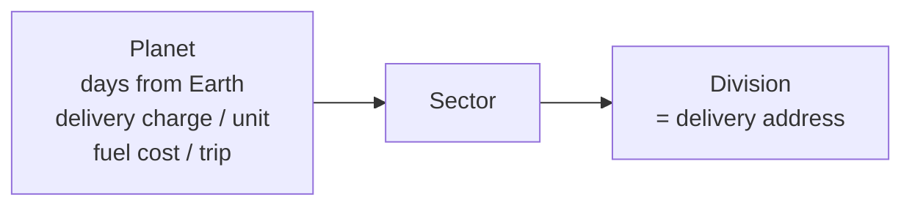
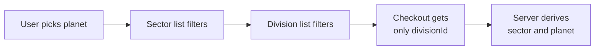

# Locations

## 1. What it does

Knows where things can be delivered: planet → sector → division. Read-only. Data comes from the seed.

Earth is not in this data. It is the origin of every trip and never a destination (D30). The 7 destinations are Mercury, Venus, Mars, Jupiter, Saturn, Uranus and Neptune.

## 2. Files

| File | Holds |
|---|---|
| `db/schema/locations.ts` | `planets`, `sectors`, `divisions` |
| `features/locations/service.ts` | 2 functions |
| `features/locations/components/LocationPicker` | Three linked selects (Client Component) |

## 3. Data it owns

| Table | Columns | Rules |
|---|---|---|
| `planets` | name, days_from_earth, delivery_charge_cents, fuel_cost_cents | Name unique. Days > 0. Money ≥ 0 |
| `sectors` | planet_id, name | Name unique inside a planet |
| `divisions` | sector_id, name | Name unique inside a sector |

Example address: Mars → Olympus Sector → Division 7.

The two money columns on `planets` are edited by the **settings** feature.

## 4. Server Actions

None.

## 5. Service functions

| Function | Role | Returns | Throws |
|---|---|---|---|
| `listLocationTree()` | Any signed-in | `[{ id, name, daysFromEarth, deliveryChargeCents, sectors: [{ id, name, divisions: [{ id, name }] }] }]`, sorted by name | `UNAUTHORIZED` |
| `getDivisionWithPlanet(divisionId)` | Internal, used by orders | `{ divisionId, sectorId, planetId, deliveryChargeCents, names }` | `INVALID` if unknown |

`listLocationTree` does not return fuel cost. Customers do not need it.

## 6. Flow

## 7. Rules to remember

- The client only ever sends a `divisionId`. The planet is always derived on the server.
- Locations cannot be created or edited in the app.
