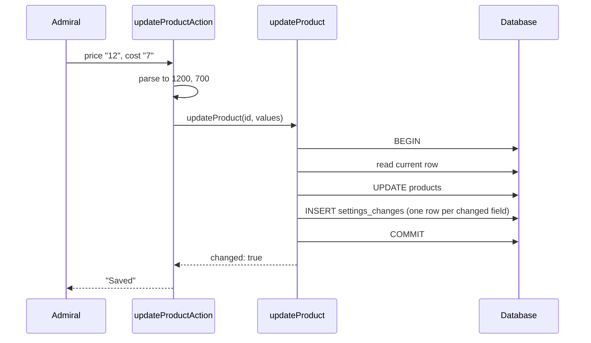

# Settings

## 1. What it does

Lets the Grand Admiral change prices and charges, and keeps a record of every change.

## 2. Files

| File | Holds |
|---|---|
| `db/schema/catalog.ts` | `products`, `settings_changes` |
| `features/settings/service.ts` | 6 functions |
| `features/settings/actions.ts` | 2 actions |
| `features/settings/schemas.ts` | Money input schemas: dollar text to cents |
| `features/settings/break-even.ts` | Pure: margin, units to cover fuel, money range check |
| `features/settings/history.ts` | Pure: entity filter from the URL, change label ("Water · price"), signed difference ("+$2.00") |
| `features/settings/components/` | `ProductTable`, `PlanetTable`, `EditMoneyDialog`, `HistoryTable` |
| `app/(app)/admiral/products`, `planets`, `history` | Pages |

## 3. Data it owns

| Table | Columns | Rules |
|---|---|---|
| `products` | name, price_cents, making_cost_cents | 5 fixed rows. No add, no delete |
| `settings_changes` | actor_id, product_id or planet_id (exactly one), field, old_value_cents, new_value_cents, changed_at | Append-only, enforced by a trigger. The service reads the current value `FOR UPDATE`, so `old_value_cents` is always the real old value |

What the Admiral can edit:

| Setting | Lives on | Applies to |
|---|---|---|
| Price | Product | New orders only |
| Making cost | Product | New orders only |
| Delivery charge per unit | Planet | New orders only |
| Fuel cost per trip | Planet | New trips only |

## 4. Server Actions

| Action | Input | Steps | Result |
|---|---|---|---|
| `updateProductAction` | productId, price, makingCost (dollar text) | Parse to cents → `updateProduct` → revalidate products page and checkout | "Saved", or "Nothing changed" |
| `updatePlanetChargesAction` | planetId, deliveryCharge, fuelCost (dollar text) | Parse to cents → `updatePlanetCharges` → revalidate planets page | "Saved", or "Nothing changed" |

Input rules for every money field: required · a number · not negative · at most 2 decimals · at most $1,000,000.

## 5. Service functions

| Function | Role | Returns | Throws |
|---|---|---|---|
| `listProducts()` | Any signed-in | `[{ id, name, priceCents }]` | `UNAUTHORIZED` |
| `listProductsForAdmiral()` | Admiral | `[{ id, name, priceCents, makingCostCents, marginCents, sellsAtLoss }]` | `FORBIDDEN` |
| `updateProduct(id, values)` | Admiral | `{ changed: boolean }` | `NOT_FOUND`, `INVALID` |
| `listPlanetsForAdmiral()` | Admiral | `[{ id, name, daysFromEarth, deliveryChargeCents, fuelCostCents, unitsToCoverFuel }]` | `FORBIDDEN` |
| `updatePlanetCharges(id, values)` | Admiral | `{ changed: boolean }` | `NOT_FOUND`, `INVALID` |
| `listSettingsChanges({ page, entity })` | Admiral | Paged `[{ id, changedAt, actorName, entity, entityName, field, oldValueCents, newValueCents }]`. Newest first, then field, then ID | `FORBIDDEN` |

`unitsToCoverFuel` = fuel cost ÷ delivery charge, rounded up. `null` when the charge is 0.

## 6. Flow

## 7. Rules to remember

- Changing a setting never changes an existing order or trip. They keep their own frozen copy.
- No history row is written when nothing changed.
- Price below making cost is allowed, with a warning.
- Only `listProducts()` is safe for non-admirals. It has no cost field.
- An action that fails returns the typed text in `values`, so the dialog shows it again.
- The history page is read-only. It has no action, and the database rejects an update or delete of a history row.
- A history row never carries an email or an internal ID of the actor or the target (D56).
- "Units needed" above 20 shows "A full ship cannot cover the fuel cost". A charge of 0 shows "Never covers fuel".
