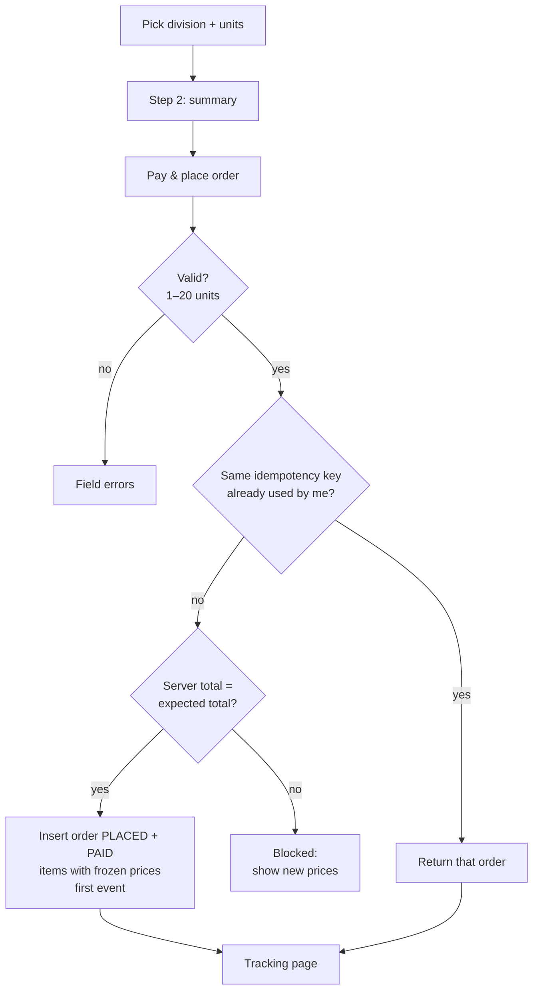
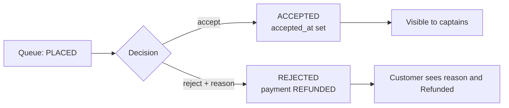

# Orders

## 1. What it does

A customer places and tracks an order. A planet manager accepts or rejects it. The Admiral can look at any order.

## 2. Files

| File | Holds |
|---|---|
| `db/schema/orders.ts` | `orders`, `order_items`, `order_events` |
| `features/orders/pricing.ts` | Pure: money formulas |
| `features/orders/status.ts` | Pure: order status machine and labels |
| `features/orders/eta.ts` | Pure: ETA text |
| `features/orders/cart.ts` | Pure: the checkout cart in the URL (D38) |
| `features/orders/waiting.ts` | Pure: waiting time and overdue flag (Phase 3) |
| `features/orders/schemas.ts` | `placeOrderSchema`, `rejectOrderSchema` |
| `features/orders/service.ts` | 10 functions |
| `features/orders/actions.ts` | 3 actions |
| `features/orders/components/` | `OrderBuilder`, `CheckoutSummary`, `PlaceOrderForm`, `OrderTable`, `OrderDetailView`, `OrderTimeline`, `ProgressSteps`, `QueueCard` (holds the reject dialog) |

## 3. Data it owns

| Table | Key columns | Rules |
|---|---|---|
| `orders` | number (shown as `ORD-1001`), idempotency_key, customer_id, planet_id, division_id, status, payment_status, total_units, trip_id, reject_reason, accepted_at, delivered_at | 1–20 units. Rejected ⇔ refunded. In a trip ⇔ status is ASSIGNED or later |
| `order_items` | product_id, units, product_name, unit_price_cents, unit_making_cost_cents, unit_delivery_charge_cents | One row per product. Name and prices frozen at checkout. No update or delete (trigger) |
| `order_events` | seq, status, actor_id, trip_id, note, occurred_at | Append-only (trigger). One row per status change. The timeline sorts by `seq`, never by `occurred_at` |

Statuses and who sets them:

| Status | Set by | Feature |
|---|---|---|
| PLACED | Customer | orders |
| ACCEPTED, REJECTED | Manager | orders |
| ASSIGNED → DELIVERED | Captain | trips |

## 4. Server Actions

| Action | Role | Input | Steps | Result |
|---|---|---|---|---|
| `placeOrderAction` | Customer | divisionId, items `[{ productId, units }]`, expectedTotalCents, idempotencyKey | Validate → `placeOrder` → revalidate order list | Redirect to `/customer/orders/[id]` |
| `acceptOrderAction` | Manager | orderId | `acceptOrder` → revalidate queue, planet orders | "Order accepted" |
| `rejectOrderAction` | Manager | orderId, reason (3–300) | Validate → `rejectOrder` → revalidate queue, planet orders | "Order rejected" |

Messages:

| Situation | Message |
|---|---|
| Empty order | "Add at least one product" |
| Over 20 units | "An order can have at most 20 units" |
| Prices changed | "Prices changed. Please review the new total." |
| Already handled | "This order was already handled" |

## 5. Service functions

**Customer**

| Function | Returns | Throws |
|---|---|---|
| `placeOrder(input)` | `{ id, number }` | `INVALID`, `CONFLICT` |
| `listMyOrders({ page, q, status })` | Paged `[{ id, number, destination, totalUnits, totalCents, status, createdAt }]` | — |
| `getMyOrder(id)` | Order detail (below) | `NOT_FOUND` |

**Manager** (always own planet, never cost or profit)

| Function | Returns | Throws |
|---|---|---|
| `listQueue()` | `[{ id, number, customerName, division, items, totalUnits, totalCents, createdAt, waitingSince }]`, oldest first | — |
| `acceptOrder(id)` | — | `NOT_FOUND`, `CONFLICT` |
| `rejectOrder(id, reason)` | — | `NOT_FOUND`, `CONFLICT` |
| `listPlanetOrders({ page, q, status })` | Paged list | — |
| `getPlanetOrder(id)` | Order detail without cost | `NOT_FOUND` |

**Admiral** (read-only)

| Function | Returns | Throws |
|---|---|---|
| `listAllOrders({ status, planetId, overdue, sort })` | Every order with planet, customer and `waitingSince`. `overdue` keeps orders waiting over 3 days. `sort: "waiting"` puts the longest waiting first. Paging and search come in Phase 4 | — |
| `getAnyOrder(id)` | Order detail plus making cost per line, profit, and the actor of each timeline step | `NOT_FOUND` |

**Order detail fields**

| Field | Customer | Manager | Admiral |
|---|---|---|---|
| Code, status, payment status, destination | ✓ | ✓ | ✓ |
| Items: product, units, unit price, delivery charge | ✓ | ✓ | ✓ |
| Product amount, delivery charges, total | ✓ | ✓ | ✓ |
| Timeline events with UTC time | ✓ | ✓ | ✓ + actor name |
| Trip number, lift-off time, ETA | ✓ | ✓ | ✓ |
| Customer name | — | ✓ | ✓ |
| Reject reason | ✓ | ✓ | ✓ |
| Making cost, profit | ✗ | ✗ | ✓ |

**Pure functions**

| Function | Purpose |
|---|---|
| `orderTotals(items)` | Units, product amount, delivery charges, customer total |
| `makingCostCents(items)` | Admiral only: what the company spent to make the order |
| `mergeLines(items)` | One line per product, zero lines dropped, 1 to 20 units or `INVALID` |
| `eventLabel(status, place, leftTrip)` | Timeline text with the real planet, sector and division (D39) |
| `parseCart`, `cartQuery`, `isCartReady` | The cart in the URL (D38) |
| `canTransition(from, to)` | Is this status change allowed |
| `customerLabel(status)` | Text the customer sees |
| `etaText(order, trip, planet)` | "About N days after lift-off" / date / "Delivered on …" |
| `waitingSince(order)` | Start of waiting (PLACED: `created_at`, ACCEPTED: `accepted_at`), or null |
| `isOverdue(since, now)` | Waiting strictly more than 3 days (D46) |
| `waitingLabel(since, now)` | "Just now" under a minute, else "Waiting 2d 5h" |
| `waitingOf(since, now)` | `{ label, overdue }` for a list row, or null |
| `parseOrderSort(value)` | `newest` (default) or `waiting` from the URL |

## 6. Flow

**Checkout**

**Manager decision**

Both decisions are one statement: `UPDATE orders ... WHERE id AND planet_id = mine AND status = 'PLACED'`. Zero rows means someone already handled it.

## 7. Rules to remember

- The server never trusts prices, totals or the planet from the client. It recomputes all of them.
- Order amounts are always calculated from `order_items`, never from current product prices.
- REJECTED is final. So is DELIVERED.
- A manager's data never contains making cost or profit, not even hidden in the page.
- Every status change adds exactly one event, in the same transaction.
- The idempotency key is looked up per customer, before prices are compared, so a resend after a price change still returns the first order (D36).
- Until Phase 4 the list functions take no arguments and return every row (D40).
- `waitingSince` is in the manager and Admiral list DTOs (`QueueOrder`, `PlanetOrderRow`) only. Customer DTOs never carry it.
- Pages work out the waiting text on the server with one `now` per request and pass it down, so a Client Component never reads the clock.
