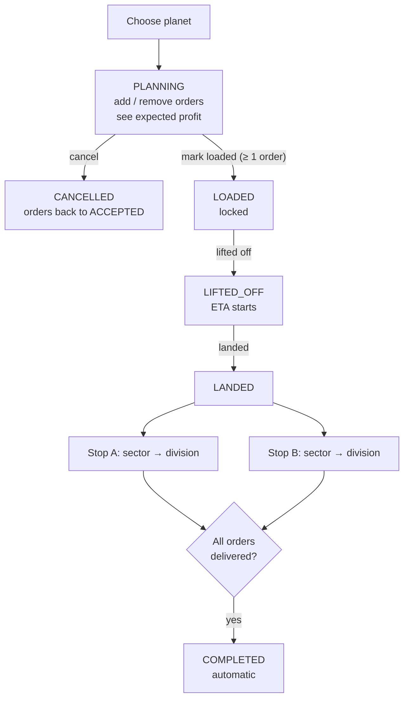
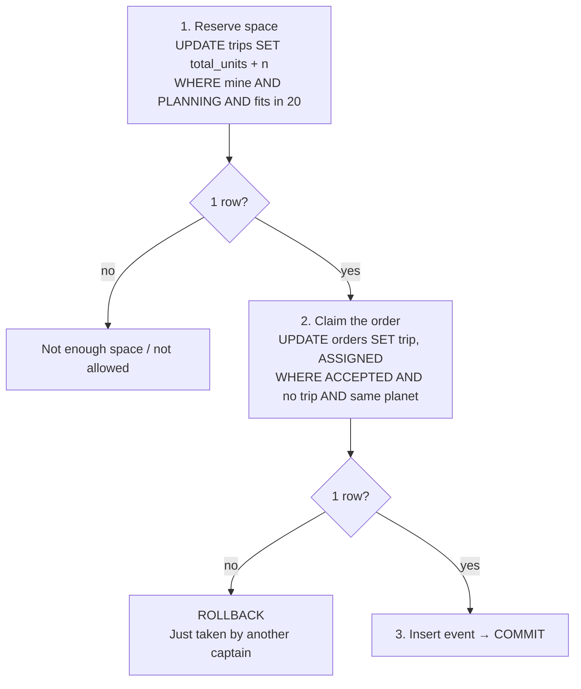

# Trips

## 1. What it does

A captain opens a trip to one planet, fills it with accepted orders (max 20 units), flies it, and delivers each division stop.

## 2. Files

| File | Holds |
|---|---|
| `db/schema/trips.ts` | `trips` |
| `features/trips/status.ts` | Pure: trip status machine |
| `features/trips/stops.ts` | Pure: group orders into stops |
| `features/trips/profit.ts` | Pure: expected profit, break-even units |
| `features/trips/schemas.ts` | ID schemas |
| `features/trips/service.ts` | 16 functions |
| `features/trips/actions.ts` | 9 actions |
| `features/trips/components/` | `PlanetChooser`, `TripBuilder`, `CapacityBar`, `OrderLines`, `TripSteps`, `StopCard`. Later phases: `ProfitSummary`, `TripTable` |

## 3. Data it owns

| Table | Key columns | Rules |
|---|---|---|
| `trips` | number (shown as `TRP-101`), captain_id, planet_id, status, total_units, fuel_cost_cents, loaded_at, lifted_off_at, landed_at, completed_at, cancelled_at | 0–20 units. One open trip per captain. Fuel cost frozen at creation |

It also writes to `orders` (status, trip_id, delivered_at) and `order_events`.

A **stop** is not a table. It is the orders of a trip that share a division.

Trip status and what the captain can do:

| Status | Captain can |
|---|---|
| PLANNING | Add, remove, cancel, mark loaded |
| LOADED | Mark lifted off |
| LIFTED_OFF | Mark landed |
| LANDED | Deliver stops, in any order |
| COMPLETED | Nothing. Start a new trip |
| CANCELLED | Nothing. Start a new trip |

## 4. Server Actions

All are captain-only and work on the captain's own trip. All revalidate `/captain/trip`.

| Action | Input | Trip must be | Effect on orders | Main errors |
|---|---|---|---|---|
| `createTripAction` | planetId | (no open trip) | — | "You already have an open trip" |
| `addOrderToTripAction` | tripId, orderId | PLANNING | ACCEPTED → ASSIGNED | "This order was just taken by another captain" · "Not enough space" |
| `removeOrderFromTripAction` | tripId, orderId | PLANNING | ASSIGNED → ACCEPTED | "The trip is already loaded" |
| `cancelTripAction` | tripId | PLANNING | All → ACCEPTED | "The trip is already loaded" |
| `markLoadedAction` | tripId | PLANNING → LOADED | All → LOADED | "Add at least one order" |
| `markLiftedOffAction` | tripId | LOADED → LIFTED_OFF | All → LIFTED_OFF | "Already done" |
| `markLandedAction` | tripId | LIFTED_OFF → LANDED | All → LANDED | "Already done" |
| `markStopAtSectorAction` | tripId, divisionId | LANDED | Stop: LANDED → AT_SECTOR | "Already done" |
| `markStopDeliveredAction` | tripId, divisionId | LANDED (→ COMPLETED if last) | Stop: AT_SECTOR → DELIVERED | "Already done" |

Delivery actions also revalidate the customer's tracking page and the reports.

## 5. Service functions

**Captain: building**

| Function | Returns | Throws |
|---|---|---|
| `listPlanetsForTrip()` | `[{ id, name, daysFromEarth, fuelCostCents, deliveryChargeCents, waitingOrders, waitingUnits, unitsToCoverFuel }]` | — |
| `getMyOpenTrip()` | Trip detail (below), or `null` | — |
| `createTrip(planetId)` | `{ id }` | `INVALID`, `CONFLICT` |
| `listAvailableOrders(tripId)` | `[{ id, number, sector, division, items: [{ product, units }], totalUnits, deliveryChargesCents, waitingSince, fits }]` | `NOT_FOUND` |
| `addOrderToTrip(tripId, orderId)` | — | `NOT_FOUND`, `CONFLICT`, `INVALID` |
| `removeOrderFromTrip(tripId, orderId)` | — | `NOT_FOUND`, `CONFLICT` |
| `cancelTrip(tripId)` | — | `NOT_FOUND`, `CONFLICT` |

**Captain: flying**

| Function | Throws |
|---|---|
| `markLoaded(tripId)` | `INVALID` (empty), `CONFLICT` |
| `markLiftedOff(tripId)` | `CONFLICT` |
| `markLanded(tripId)` | `CONFLICT` |
| `markStopAtSector(tripId, divisionId)` | `NOT_FOUND`, `CONFLICT` |
| `markStopDelivered(tripId, divisionId)` | `NOT_FOUND`, `CONFLICT` |

**History**

| Function | Role | Returns |
|---|---|---|
| `listMyTrips({ page, status })` | Captain | Paged trips with units, earnings, fuel, profit |
| `getMyTrip(id)` | Captain | Trip detail |
| `listAllTrips({ page, q, status, planet })` | Admiral | Paged trips with captain name |
| `getAnyTrip(id)` | Admiral | Trip detail with captain name |

**Trip detail fields**

`id, number, planet, status, totalUnits, fuelCostCents, earningsCents, expectedProfitCents, unitsToBreakEven, timestamps, orders[], stops[]`

Each stop: `{ divisionId, sector, division, orders: [{ number, items: [{ product, units }] }], units, state }` where state is `pending`, `at_sector` or `delivered`.

**What a captain sees of an order (D29):** number, sector, division, products with units (for example "3 Water, 1 Food"), total units, delivery charges. **Never:** product price, making cost, customer name.

**Pure functions**

| Function | Purpose |
|---|---|
| `canTripTransition(from, to)` | Is this trip status change allowed |
| `groupStops(orders)` | Orders → stops by division, with each stop's state |
| `expectedProfit(orders, fuelCost)` | Earnings − fuel |
| `unitsToBreakEven(…)` | Units still needed, or "cannot cover fuel" |

## 6. Flow

**Whole trip**

**Adding an order safely** (one transaction)

## 7. Rules to remember

- **Every trip action touches the trip row first.** Add and remove start with `UPDATE trips`. Every other action starts with `SELECT ... FROM trips WHERE id = ? AND captain_id = me FOR UPDATE`. Two tabs of one captain then run one after the other, so the second one sees the first one's delivery and completes the trip.
- **The database re-checks the trip at commit** (`database.md` 3.8): units equal the orders, every order's status fits the trip's, and a fully delivered trip is COMPLETED. A failure there is a `check_violation`, returned as `CONFLICT` ("Something changed, try again").
- The unit counter cannot change after PLANNING, and the trip's captain, planet and fuel cost never change.
- Every step is `UPDATE ... WHERE status = expected`. A second click changes nothing and reports "Already done".
- Trip-level steps move every order in the trip together, with one event per order.
- The trip completes itself in the same transaction as the last delivery.
- Fuel cost is copied onto the trip when it is created and never changes after.
- Loading a loss-making trip is allowed. The captain is warned first.
- No time gate: a captain can mark Landed at any moment after lift-off.
- Remove and cancel also start with the locking `SELECT`. Only add starts with `UPDATE trips`, because its `WHERE` is the capacity check.
- The last `markStopDeliveredAction` redirects to `/captain/trip?completed=<tripId>`. The page reads that trip with `getMyTrip` and shows the "Trip completed" summary above the planet list.
- Built in Phase 1: the 12 building and flying functions plus `getMyTrip`. `listMyTrips`, the Admiral functions, and the profit and waiting fields come in Phases 2 and 3.
