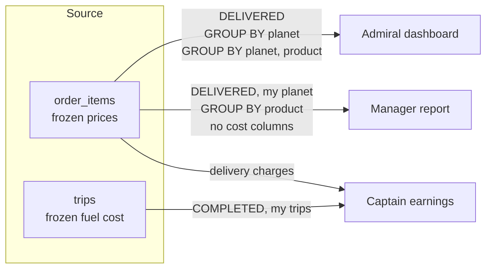
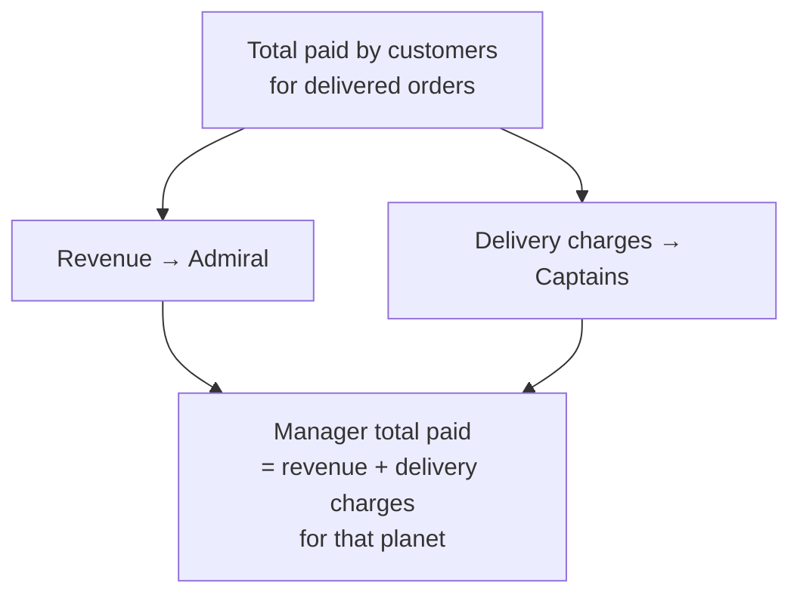

# Reports

## 1. What it does

Answers the money questions for each role. Read-only. It owns no tables and has no actions.

| Role | Question |
|---|---|
| Admiral | How much of what was delivered to which planet, and what did we earn? |
| Manager | What did my planet buy? |
| Captain | What did I earn? |

## 2. Files

| File | Holds |
|---|---|
| `features/reports/range.ts` | Pure: parse and validate a date range |
| `features/reports/ranking.ts` | Pure: profit descending, ties by name. Used by the summary and the table |
| `features/reports/service.ts` | 10 functions. 7 built in Phase 2, `getOverdueCount` in slice 3.2, `getProfitSeries` and `getPlanetSpendSeries` in Phase 7 |
| `features/reports/series.ts` | Pure: `seriesUnit`, `previousPeriod`, `percentChange`, `bucketLabel` (D64) |
| `features/reports/components/` | `TotalsCards`, `PlanetProfitSummary`, `PlanetProductTable`, `PipelineList`, `PurchasesTable`, `EarningsSummary`, `OverdueCard` |
| `app/(app)/admiral`, `manager/report`, `captain/trips` | Pages |

## 3. Data it reads

| Source | Used for |
|---|---|
| `order_items` (frozen prices) + `orders` | Company and planet numbers |
| `trips` (frozen fuel cost) + their orders | Captain numbers |

**The one counting rule**

| Counts | When |
|---|---|
| An order | Status DELIVERED, by `delivered_at` |
| A trip | Status COMPLETED, by `completed_at` |
| "In progress" | Accepted but not yet delivered. Shown separately |
| Never | REJECTED orders, CANCELLED trips |

**Formulas**

| Number | Formula |
|---|---|
| Revenue | Σ units × unit price |
| Making cost | Σ units × unit making cost |
| Company profit | Revenue − making cost |
| Delivery charges | Σ units × unit delivery charge |
| Total paid | Revenue + delivery charges |
| Captain profit | Delivery charges of the trip − fuel cost of the trip |

## 4. Server Actions

None. Filters are URL parameters (`from`, `to`).

## 5. Service functions

| Function | Role | Input | Returns |
|---|---|---|---|
| `getCompanyTotals(range)` | Admiral | from, to | `{ unitsDelivered, revenueCents, makingCostCents, profitCents }` |
| `getPlanetProfitSummary(range)` | Admiral | from, to | `[{ planet, units, revenueCents, makingCostCents, profitCents }]`. Every planet, sorted by profit, ties by name (D32) |
| `getPlanetProductTable(range)` | Admiral | from, to | `[{ planet, rows: [{ product, units, revenueCents, makingCostCents, profitCents }], subtotal }]`. Every planet, zeros included, same planet order as the summary |
| `getPipeline()` | Admiral | — | `[{ status, count, oldestWaitingSince }]` for all 9 statuses. `oldestWaitingSince` is set only for PLACED and ACCEPTED |
| `getOverdueCount()` | Admiral | — | `{ count }` of orders waiting over 3 days |
| `getProfitSeries(period)` | Admiral | start, end | `{ unit, points: { date, revenueCents, profitCents }[] }`. One point per day, month or year, empty ones included. The points add up to the totals |
| `getPlanetSpendSeries(period)` | Manager | start, end | `{ unit, points: { date, totalPaidCents }[] }` for the own planet. No cost, no profit |
| `getPlanetPurchases(range)` | Manager | from, to | `{ rows: [{ product, units, productAmountCents, deliveryChargesCents, totalPaidCents }], total }` |
| `getPlanetInProgress()` | Manager | — | Same shape as `getPlanetPurchases`, for orders ACCEPTED to AT_SECTOR (D31) |
| `getMyEarnings()` | Captain | — | `{ trips, units, earningsCents, fuelCents, profitCents }` over completed trips |

All throw `FORBIDDEN` for a wrong role. Manager functions take the planet from the session, never from input.

**Pure**

| Function | Purpose |
|---|---|
| `parseRange(from, to)` | Valid range, or the default (today and the 30 days before, D41). End date inclusive. UTC |
| `rangeError(from, to)` | The message the date form shows, or null |
| `byProfitThenName(a, b)` | The one sort rule for planets |

## 6. Flow

**How the three reports agree**

## 7. Rules to remember

- All sums are done by the database, on frozen values. Never in JavaScript, never from current prices.
- Manager queries do not select cost columns at all, so there is nothing to leak.
- Planets and products with no deliveries still appear, as zeros.
- The dashboard answers "which planets are profitable" first: the summary is sorted by profit.
- The manager's two tables never overlap. An order is in "In progress" or in "Delivered", not both.
- The pipeline and overdue count ignore the date range. They show the present.
- The overdue count and the filtered Admiral list use one SQL condition (`overdueOrders` in the orders service), so the card and the list behind its link cannot disagree (D47).
- A negative profit is shown in red with a minus sign.
- A planet's subtotal comes from the same query as its product rows (`GROUPING SETS`), so it cannot drift from them.
- The captain's per-trip numbers come from `listMyTrips` in `lld/05-trips.md`. A cancelled trip counts as zero (D43).
