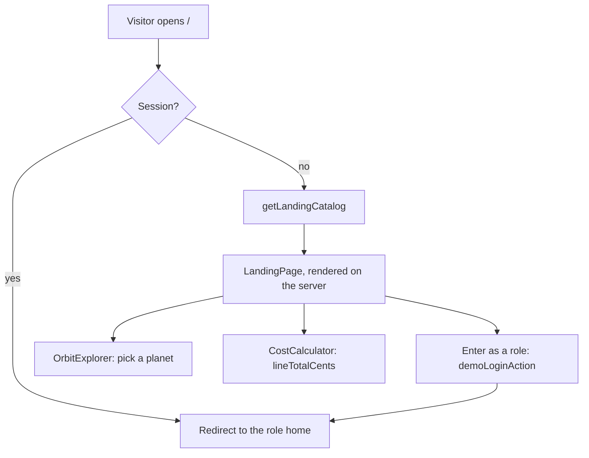

# Landing

## 1. What it does

The public page on `/`. It tells a visitor what the company does, lets them pick a planet and price a delivery, and gets them into the demo. A signed-in user never sees it: `/` redirects to the role home.

Its look comes from `../../design.md` (D65), not from the dashboard theme.

## 2. Files

| File | Holds |
|---|---|
| `features/landing/service.ts` | `getLandingCatalog`, the one public read (D66) |
| `features/landing/orbit.ts` | Pure: `EARTH`, `ORBITS` (ring, dot, color, period, start angle, joke), `PLUTO`, `starField`, `routeBetween` |
| `features/landing/steps.ts` | Pure: the four roles in order, each with its demo account |
| `components/ui/singularity-horizon.tsx` | Client: the hero scene. A WebGL2 accretion disk on a canvas, a title and status that cycle, readouts, and a slot for the headline and links |
| `components/ui/singularity-states.ts` | Plain data: the three looks of the scene. The page replaces their words |
| `features/landing/components/landing-page.tsx` | Server: nav, numbers, section order |
| `features/landing/components/orbit-explorer.tsx` | Client: the orbit, planet list, readout, route |
| `features/landing/components/how-it-works.tsx` | Server: the flight line and the role cards |
| `features/landing/components/demo-entry.tsx` | Client: form and button around `demoLoginAction` |
| `features/landing/components/cost-calculator.tsx` | Client: planet, product, units, total |
| `features/landing/components/launch-pad.tsx` | Client: countdown and lift-off |
| `features/landing/components/count-up.tsx` | Client: a number that counts up when seen |
| `features/landing/components/landing-footer.tsx` | Server: footer |
| `features/landing/components/styles.ts` | Class strings shared by the components: pills, labels, headline |
| `app/page.tsx` | The route |
| `app/globals.css` | The `.landing` tokens and the landing keyframes |

## 3. Data it owns

None. It reads `planets` and `products`.

## 4. Server Actions

None of its own. The role cards submit `demoLoginAction` from auth.

## 5. Service functions

| Function | Access | Returns |
|---|---|---|
| `getLandingCatalog` | Public | `{ planets: { name, daysFromEarth, deliveryChargeCents }[], products: { name, priceCents }[] }` |

Planets are sorted by days from Earth, so the first is the nearest and the last the farthest. No id, no fuel cost, no making cost, no profit.

## 6. Flow

## 7. Rules worth knowing

| Rule | Why |
|---|---|
| Rings turn with a CSS `rotate` animation that starts from the angle in `--start` | The server render already has every planet in place, and reduced motion keeps them there |
| A label counter-turns inside its ring | It stays level while the ring turns |
| On select the state is committed with `flushSync` before measuring | The orbit must be frozen, or the route would miss the planet |
| The route is stored in percent of the frame | It still fits after a resize |
| The map buttons are `aria-hidden` with `tabIndex={-1}` | The planet list is the one control for keyboard and screen reader |
| Landing classes sit in `@layer components` | Tailwind utilities still win over them |
| The page root has `overflow-x: clip` | A turned ring has a wider bounding box than the circle it draws |
| The hero scene draws only while an `IntersectionObserver` sees the canvas | A full-screen WebGL scene is the most expensive thing on the page |
| The scene states are in a file without `"use client"` | A Server Component cannot read a value exported by a client module |
| The hero canvas uses `touch-action: pan-y` | With `none` a phone could not scroll past a full-screen canvas |
